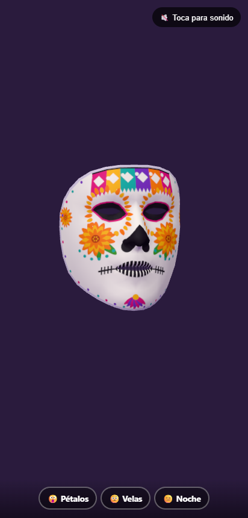
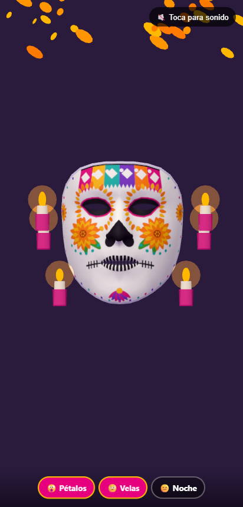
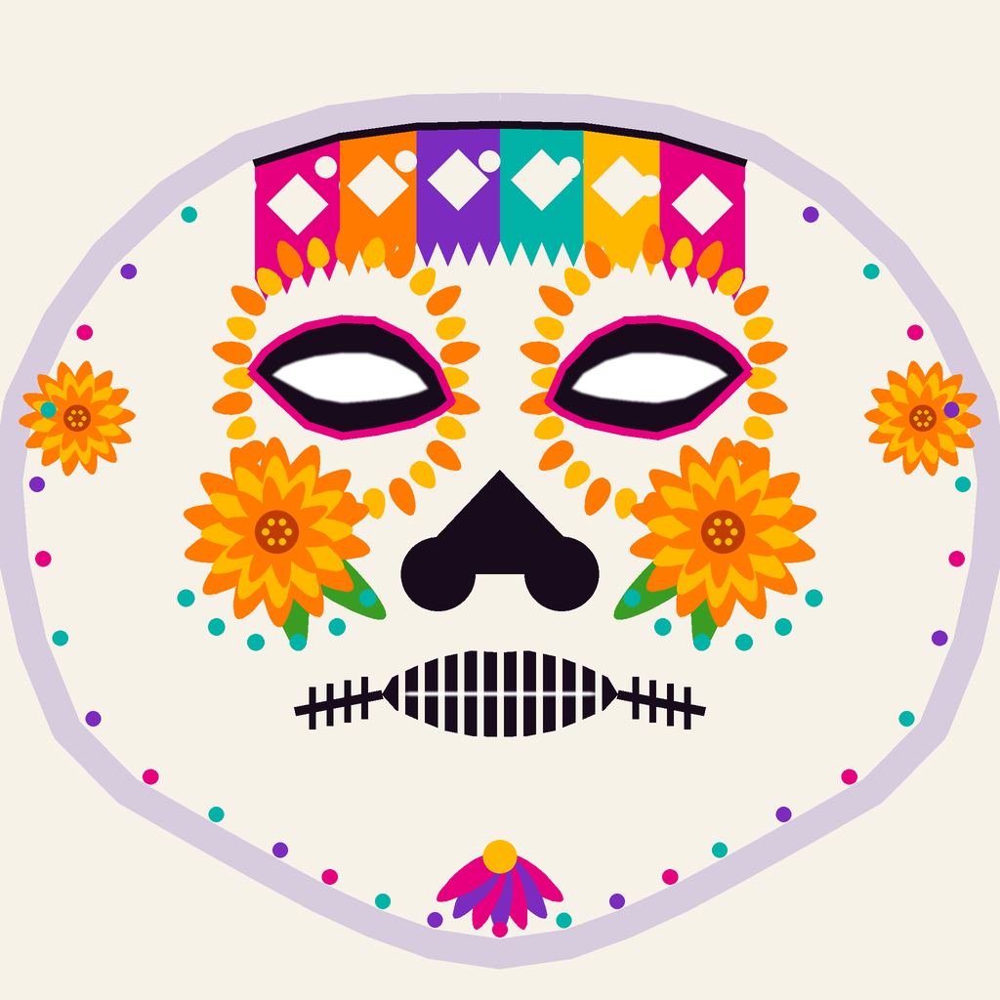

# Calavera de Cempasúchil

Máscara de **Día de Muertos** en realidad aumentada, **mapeada a la malla facial** del usuario. La textura está pintada sobre el mapa UV del modelo canónico de MediaPipe, así que ojos, nariz, boca y contorno quedan alineados y la máscara **se deforma con tus gestos** sin desprenderse. Ojos y boca interior son transparentes.

> Actividad 3 · Realidad Virtual y Aumentada · 2026 · mejora de la Actividad 2 (repositorio `02-filtro-alebrije`)

**Pruébalo:** https://mascara-dia-muertos-ar.carlos-gomez-dev13.workers.dev/ · **Modo demo en PC:** https://mascara-dia-muertos-ar.carlos-gomez-dev13.workers.dev/?demo

| Máscara sobre la malla | Pétalos y veladoras | Textura sobre el UV |
|---|---|---|
|  |  |  |

## Diseño

Calavera oaxaqueña con los elementos tradicionales del Día de Muertos:

- **Calavera:** cuencas oscuras con borde rosa mexicano, nariz de corazón invertido y sonrisa cosida que se extiende a las mejillas.
- **Cempasúchil:** flores de varias capas en mejillas y sienes, y una corona de pétalos alrededor de cada cuenca.
- **Papel picado:** guirnalda de seis colores con recortes de rombo y círculos sobre la frente.
- **Detalles:** abanico de pétalos en la barbilla y un borde de puntos que sigue el óvalo del rostro.

Hay dos variantes: **cempasúchil** (naranja y amarillo) y **noche** (morado y rosa, como la noche de vela en el panteón).

## Gestos y efectos

| Gesto | Señal | Efecto |
|---|---|---|
| 😮 Abrir la boca | `jawOpen > 0.5` | **Lluvia de pétalos** de cempasúchil que caen girando, con campanas |
| 🤨 Subir las cejas | `browInnerUp > 0.55` | Se encienden **6 veladoras** alrededor del rostro, con flamas que titilan, y se apagan a los 5 s |
| 😑 Parpadear fuerte | ambos `eyeBlink > 0.6` | **Cambio de color** de día a noche, con un destello |

Cada gesto usa un umbral, un rearme y una pausa mínima (`js/gestos.js`, con prueba en `js/gestos.test.mjs`).

## Cómo se logró el ajuste preciso

1. **Malla con UV:** `textura/obj_a_json.py` convierte el modelo canónico de MediaPipe (`canonical_face_model.obj`, 468 vértices y 898 triángulos) a `assets/malla_facial.json`. El índice de cada vértice coincide con el índice de landmark de MediaPipe.
2. **Plantilla UV:** `textura/plantilla_uv.png` es la malla exportada como imagen, con ojos, boca y óvalo marcados, para pintar encima en Krita o Photoshop.
3. **Textura anclada a landmarks:** `textura/generar_textura.py` dibuja cada elemento en la posición UV de los landmarks: las cuencas sobre los contornos de los ojos, la nariz entre las fosas (98, 327) y el puente (195), las puntadas de comisura a comisura (61, 291), las flores en las mejillas (50, 280). Así queda alineado por construcción. Se dibuja a 2048 px y se reduce a 1024 px para suavizar bordes. Los ojos y la boca interior quedan con **alfa 0**, porque en la malla canónica esas aberturas sí tienen triángulos.
4. **Malla deformable:** en cada cuadro los 468 vértices de una `BufferGeometry` se mueven a los landmarks del rostro (cámara ortográfica en píxeles del video) y se recalculan las normales. La máscara sigue la boca, las cejas y los párpados.

## Mejora frente a la Actividad 2

| | Actividad 2: Zorro de fiesta | Actividad 3: Calavera |
|---|---|---|
| Ajuste | Modelo rígido colocado con la matriz de transformación facial | **Malla que se deforma** con los 468 landmarks |
| Gestos | La máscara no cambia de forma | La boca se abre y los párpados se cierran **con** la máscara |
| Ojos y boca | Huecos fijos en los ojos; la boca queda bajo el hocico | **Transparentes** y siguen tu cara: se ven tus ojos y tus dientes |
| Textura | La del modelo de Meshy, independiente de tu rostro | Textura pintada sobre el **mapa UV** facial, sin costuras |
| Efectos | Confeti, color, brillo | Pétalos, veladoras y cambio día/noche, con tema de Día de Muertos |

## Herramientas

- MediaPipe Tasks Vision 0.10.14: Face Landmarker con 468 landmarks y blendshapes.
- three.js 0.160: BufferGeometry dinámica y MeshStandardMaterial.
- Python + Pillow: plantilla UV y textura.
- Web Audio API: campanas sintetizadas.

## Instalación y uso

```bash
git clone https://github.com/CharlieMorales13/mascara-dia-muertos-ar.git && cd mascara-dia-muertos-ar
npx serve .
```

- Requiere **HTTPS** o `localhost` para la cámara. Para el teléfono, publica la carpeta en **Vercel** o **Cloudflare Pages** (estático, sin build).
- La app abre directo en la cámara frontal. El sonido se activa con el primer toque.
- `index.html?demo`: malla canónica girando sin cámara. Teclas 1, 2 y 3 para los efectos.
- `index.html?imagen=foto.jpg`: aplica la máscara a una foto.
- Regenerar texturas: `pip install pillow && python textura/generar_textura.py`.
- Prueba de gestos: `node js/gestos.test.mjs`.

**Consejos para probar:** varias personas, con lentes, con luz de frente y de lado. La textura usa colores saturados y contornos gruesos porque el detalle fino se pierde en la cámara.

## Créditos y licencias

| Recurso | Autor / fuente | Licencia |
|---|---|---|
| Código, diseño de la calavera y texturas | Carlos Antonio Gómez Morales | MIT (ver `LICENSE`) |
| Campanas y efectos | Sintetizados en código, autoría propia | MIT |
| Veladoras (`assets/veladora.glb`, reducidas en la Actividad 4) | [Candles Asset Pack](https://sketchfab.com/3d-models/candles-asset-pack-56a68205dae649a388c6e3ba04145a9e) de [Em Marshall](https://sketchfab.com/emarshall) | CC BY 4.0 |
| Modelo facial canónico y mapa UV (`canonical_face_model.obj`) | Google, MediaPipe | Apache 2.0 |
| MediaPipe Tasks Vision y modelo Face Landmarker | Google | Apache 2.0 |
| three.js | three.js authors | MIT |

Diseño hecho con respeto a la tradición del Día de Muertos oaxaqueño: la calavera, el cempasúchil que guía a las almas y el papel picado de las ofrendas.
